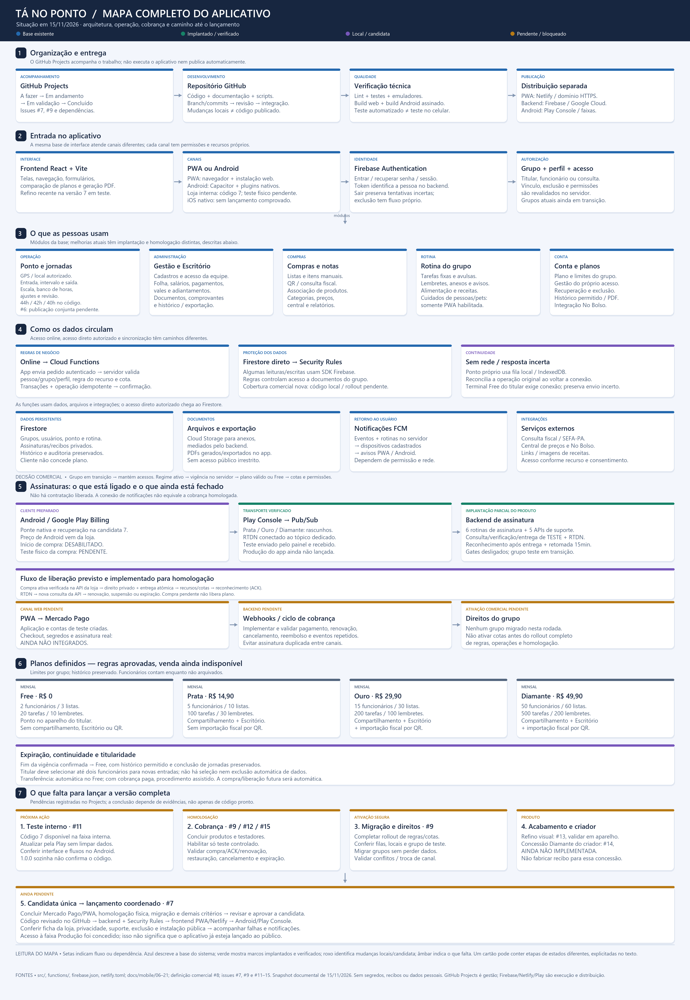

# Fluxograma completo — estado em 15/11/2026

Imagem PNG de 4000 × 5790 pixels, conferida visualmente. Abrir em tamanho original e usar zoom para ler o mapa completo. Não contém credenciais, dados pessoais, tokens de compras nem detalhes de usuários.

## Escopo

- Gestão do trabalho: GitHub Projects, issues, código, revisão, testes e entregas separadas.
- Frontend React/Vite, PWA/Netlify e Android/Capacitor; identidade Firebase, grupos e perfis.
- Ponto, escalas/jornadas, Escritório/folha/documentos, compras/QR/central de preços, tarefas, alimentação, lembretes/avisos/cuidados, conta e No Bolso.
- Fluxos online, operações idempotentes, Firestore direto/Security Rules, fila local e reconciliação, arquivos/Cloud Storage, PDFs e FCM.
- Assinaturas: ponte Play Billing, Console/RTDN/PubSub, Functions de verificação/entrega/ACK/retomada e direitos privados; canal Mercado Pago pendente.
- Planos comerciais aprovados e limites; expiração, preservação de histórico e transferência de titularidade.
- Lacunas até produção: candidata interna/física, cobertura de regras/cotas, migração, ciclo de cobrança, concessão do criador, acabamento e publicação coordenada.

## Como interpretar

Azul descreve a base existente do produto, sem declarar cada alteração recente como publicada. Verde identifica marcos de implantação e verificação. Roxo representa preparação local/candidata ou comportamento comercial ainda sem ativação. Âmbar mostra entregas pendentes. O texto de cada cartão esclarece quando o componente contém etapas em estados diferentes.

O snapshot separa: código 7 enviado e disponível na faixa interna, com homologação física pendente; 6 rotinas de assinatura e 5 APIs de suporte implantadas; conexão de notificações com teste pela Play Console confirmada; gates desligados e grupos em transição. Isso **não** significa compra, ACK, migração ou lançamento público homologados.

## Fontes verificadas

- `README.md`, `package.json`, `src/App.jsx`, `src/services/`, `functions/`, `firebase.json`, `netlify.toml`.
- `docs/PLANOS-E-ASSINATURAS.md`, `docs/ASSINATURAS-IMPLEMENTACAO.md` e roteiros `docs/mobile/06` a `21`.
- Issues #7, #9, #11, #12, #13, #14 e #15 consultadas nesta rodada; definição #8 e adaptação de jornada #6 referenciadas nos documentos.
- Evidências de implantação e candidata existentes em `output/`, preservadas fora do Git.

Não foi feito novo deploy, ativação, upload à Play ou alteração de dados operacionais para produzir o mapa. Não é um inventário em tempo real da infraestrutura: novas entregas exigem atualizar os rótulos e a data.

## Atualização da imagem

Fonte editável: `scripts/gerar-fluxograma-app.py`. Requer Python com Pillow e fontes Segoe UI do Windows. Os dados e status estão declarados no script; revisá-los junto dos documentos/issues antes de regenerar. A geração recusa cartões cujo texto exceda o espaço disponível.

Imagem, documentação e fonte estão no checkout local; esta rodada registra a entrega na issue #9 do Projects, sem efetuar commit/push do conjunto de alterações acumuladas.
